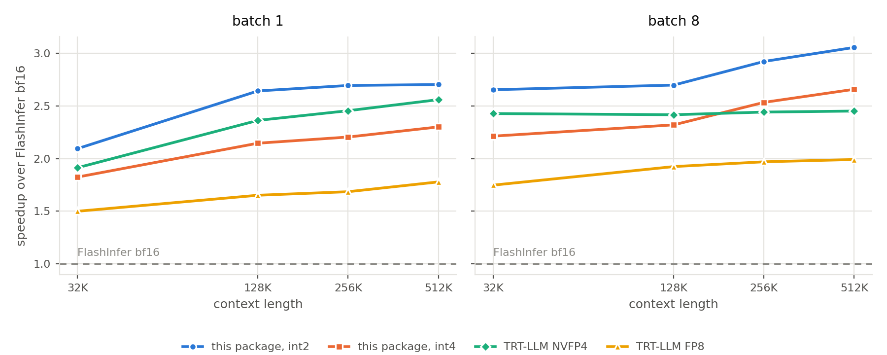

# cutedsl-decode

Quantized-KV paged GQA decode kernels for Hopper (SM90) and Blackwell (SM100),
written in CuTe DSL and exposed through one architecture-agnostic wrapper.

K and V live in the cache as 2-bit or 4-bit packed integer values plus a separate
scale-and-offset pool. The kernels dequantize on chip and never materialize a
16-bit KV tile, so a decode step reads a fraction of the bytes it would read from
a bf16 cache. At 2 bits the cache costs about 2.5 bits per value including the
scale and offset, which is 6.4 times smaller than bf16 and 1.8 times smaller than
nvfp4.

## Install

From a source checkout:

```sh
git clone https://github.com/donglinz/fosca.git
cd fosca
pip install -e ".[cu13]"    # CUDA 13: Blackwell, and Hopper
pip install -e ".[cu12]"    # CUDA 12: Hopper only
```

The same extras work with `pip install "cutedsl-decode[cu13]"` once the package
is published to PyPI.

The package contains no compiled extensions. Everything is JIT-compiled by
`nvidia-cutlass-dsl` on first use, and the result is memoized in process and
cached on disk across processes. Bring your own `torch>=2.4`.

Blackwell requires the `cu13` extra. The DSL's CUDA 12 backend miscompiles the
SM100 kernel, and the package refuses to compile it under that backend rather
than producing a wrong result.

## Quickstart

```python
import torch
from cutedsl_decode import PagedDecodeWrapper, get_capabilities, pool

device = "cuda"
arch = get_capabilities()["arch"]                 # "sm90" or "sm100"
q_dtype = torch.float8_e4m3fn if arch == "sm100" else torch.bfloat16

batch, kv_heads, q_heads, head_dim, page_size = 8, 8, 32, 128, 64
pages_per_seq, bits = 64, 2

# A logical KV cache: [batch, pages, page_size, kv_heads, head_dim], bf16.
k_log = torch.randn(batch, pages_per_seq, page_size, kv_heads, head_dim,
                    device=device, dtype=torch.bfloat16)
v_log = torch.randn_like(k_log)

# Build the packed pools and the physical block table.
k_pool, v_pool, scale_pool, block_table, _aux = pool.build_pools_flex(
    k_log, v_log, bits, k_store_perm=pool.k_store_perm_sm100_f4(bits),
    v_store_perm=pool.v_store_perm_sm100_f4(bits))

# Page-table inputs.
indptr = torch.arange(batch + 1, device=device, dtype=torch.int32) * pages_per_seq
indices = block_table.reshape(-1).to(torch.int32)
seq_lens = torch.full((batch,), pages_per_seq * page_size, device=device,
                      dtype=torch.int32)

q = torch.randn(batch, q_heads, head_dim, device=device,
                dtype=torch.bfloat16).to(q_dtype)

w = PagedDecodeWrapper(torch.empty(256 * 1024 * 1024, dtype=torch.uint8,
                                   device=device))
w.plan(indptr, indices, seq_lens,
       num_qo_heads=q_heads, num_kv_heads=kv_heads, head_dim=head_dim,
       page_size=page_size, q_data_type=q_dtype, bits=bits)

out = w.run(q, k_pool, v_pool, scale_pool=scale_pool,
            k_pool_order="permuted")     # [batch, q_heads, head_dim]
```

`plan()` compiles the kernel for one static configuration and is called when the
page table or the sequence lengths change. `run()` is called every decode step
and is graph-capturable. Call `plan()` once at model load to pay the JIT cost
before the first request.

Two arguments in `run()` are worth hoisting out of the hot path: passing `out=`
avoids an allocation per call, and passing `pscale_lp=w.pscale_lp(scale_pool)`
avoids a device synchronisation per call.

## Support matrix

| | SM90 (Hopper) | SM100 (Blackwell) |
|---|---|---|
| Paged GQA decode | yes | yes |
| `bits` | 2, 4 | 2, 4 |
| Q dtype | bf16 | fp8 e4m3 |
| K/V | packed uint8 pools + scale pool | packed uint8 pools + scale pool |
| head_dim | 128; 256 with token-wise K and V and an f32 scale pool | 128 |
| page_size | 64 | 64 |
| reductions | none, kernel (split-K with LSE merge) | none, kernel (split-K with LSE merge) |
| GQA group size | up to 8 | up to 8 |
| quantized granularity | token 128/64, channel 64/128/256 | token 128/64, channel 64/128/256 |

`get_capabilities()` reports the same set for the running device. Requesting a
configuration outside it raises `ValueError` or `NotImplementedError` naming what
is supported.

## Building pools

Both architectures ship a builder that turns a bf16 KV cache into the packed
pools their kernel reads.

On Blackwell, `cutedsl_decode.pool` packs the pools and also carries a reference
implementation of the same attention, so a kernel run can be checked against a
storage-matched oracle:

```python
from cutedsl_decode import pool

k_pool, v_pool, scale_pool = pool.build_pools_lut(
    k, v, bits,                                  # k, v: [pages, 64, kv_heads, dim]
    k_store_perm=pool.k_store_perm_sm100_f4(bits),
    v_store_perm=pool.v_store_perm_sm100_f4(bits))
```

On Hopper, `cutedsl_decode.pool_sm90` quantizes and repacks into the chunk-major
pools the SM90 kernel reads, and lays the pages out as one global pool behind a
block table:

```python
from cutedsl_decode import pool_sm90

cache = pool_sm90.build_pools_sm90(
    k, v, bits,                                  # k, v: [batch, kv_heads, kv_len, dim]
    seq_lens=seq_lens)                           # -> codes_k, codes_v, scales, block_table
```

The stored integer values are permuted in a way the kernel requires and the bytes
do not reveal. Ask the builder for the permutation rather than reproducing it:
`k_store_perm_sm100_f4` / `v_store_perm_sm100_f4` on Blackwell, and the
`order=` argument on Hopper, which defaults to the `chunk16` order the SM90
kernel reads. On Blackwell, `run()` refuses a K pool whose order the caller has
not declared through `k_pool_order`.

## Accuracy

`baselines`-style end-to-end scoring is not part of this release. What the
package ships is the reference implementation in `cutedsl_decode.pool`, whose
`dequant_pools_flex` inverts a pool and `ref_paged_attention_fp8q_flex` scores
attention over the dequantized logical stream through the block table. Comparing
a kernel run against that reference measures the kernel's own error, because
both sides consume the same integer values, the same scale and offset, and the
same Q dtype.

## Benchmarks

Decode latency normalized against FlashInfer bf16 at the same shape, so 1.00 is
FlashInfer bf16 and lower is better. The absolute latency in microseconds is in
the figure below and in `benchmarks/decode_latency.csv`.



| Batch | KV len | int2 | int4 | FlashInfer bf16 | TRT-LLM FP8 | TRT-LLM NVFP4 | bf16 (us) |
|---:|---:|---:|---:|---:|---:|---:|---:|
| 1 | 8K | **0.71x** | 0.77x | 1.00x | 0.78x | 0.81x | 16.1 |
| 1 | 32K | **0.47x** | 0.56x | 1.00x | 0.65x | 0.52x | 35.3 |
| 8 | 8K | **0.41x** | 0.51x | 1.00x | 0.57x | 0.41x | 55.5 |
| 8 | 32K | **0.38x** | 0.45x | 1.00x | 0.57x | 0.41x | 166.9 |
| 32 | 8K | **0.38x** | 0.44x | 1.00x | 0.56x | 0.42x | 170.2 |
| 32 | 32K | **0.36x** | 0.43x | 1.00x | 0.53x | 0.42x | 602.4 |
| 128 | 8K | **0.36x** | 0.41x | 1.00x | 0.52x | 0.37x | 600.4 |
| 128 | 32K | **0.33x** | 0.38x | 1.00x | 0.51x | 0.36x | 2323.6 |

The last column is the reference each row is divided by, so a row can be read
back as absolute latency.

What the columns store per cached value, including the scale and offset:

| | int2 | int4 | NVFP4 | FP8 | bf16 |
|---|---:|---:|---:|---:|---:|
| bits per value | 2.5 | 4.5 | 4.5 | 8 | 16 |

Two things follow from that table and are worth stating plainly.

The 2-bit kernel reads about 1.8 times fewer bytes than NVFP4 and takes 0.86 to
1.00 of its latency, so the traffic saving does not turn into latency: the
dequantization and the on-chip work absorb most of it. Against bf16, which
stores 6.4 times as many bits per value, it takes 0.33 to 0.71.

At 4 bits, where this package and NVFP4 store the same number of bits per value,
the two are close and TRT-LLM is faster at seven of the eight shapes. The 2-bit
setting is where this kernel wins.

Measurement conditions: one query token per request, 32 query heads over 8 KV
heads, `head_dim` 128, page size 64, paged cache, fp8 Q for this package and for
TRT-LLM, bf16 for FlashInfer. All five columns were measured on the same B200
card on 2026-10-28, in one session, through one timing function. The reported
number is the CUDA kernel span from CUPTI, over a cold L2, as the median of the
fully observed iterations. It excludes host dispatch and the paged-attention
wrapper around the kernel, so it is not an end-to-end serving latency.

Which code produced each column:

- **int2 and int4** were measured by driving `PagedDecodeWrapper` from this
  release. `benchmarks/decode_latency.csv` holds the values and
  `benchmarks/plot_decode.py` renders the figure above.
- **FlashInfer and TRT-LLM** were measured by the project's benchmark harness,
  which is not part of this release. Those three columns cannot be regenerated
  from this repository.

## Testing

```sh
pytest -q            # CPU suite: no GPU and no CUDA toolkit required
pytest -m gpu        # the pool builders, on the hardware their kernel runs on
```

A test module whose name ends in `_cpu` must pass with no GPU. The CPU suite
runs in about ten seconds.

With a CUDA device and the CuTe DSL installed, the modules that need them run
instead of skipping. The GPU test builds pools with the builder this package
ships for the running architecture, runs the decode kernel on them, and scores
the output against a storage-matched reference, so the pool contract and the
kernel are one gate.

Both architectures were checked that way: an H100 for `pool_sm90`, a B200 for
`pool`. The worst per-(batch, head) relative L2 is under 3e-3 at int2 and int4
on both.

## Limitations

- Only the quantized path exists. There is no dense bf16, fp16 or fp8 KV mode.
- `head_dim` 256 on SM90 requires token-wise K and V with an f32 scale pool.
- The benchmark harness that produced the competitor columns in
  [Benchmarks](#benchmarks) is not part of this release.
- The benchmark table is Blackwell only. No Hopper numbers are published.

## License

Apache-2.0. This package derives from FlashInfer (Apache-2.0) and the NVIDIA
CUTLASS Hopper FMHA example (BSD-3-Clause), and redistributes subsets of QuACK
and flash-attention (both BSD-3-Clause). See [NOTICE](NOTICE).
