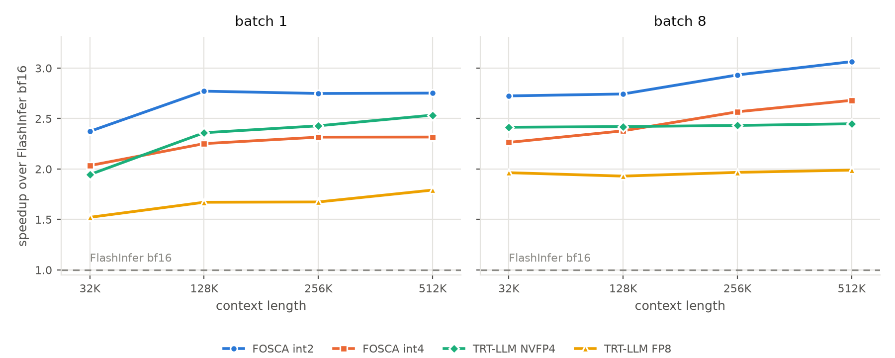
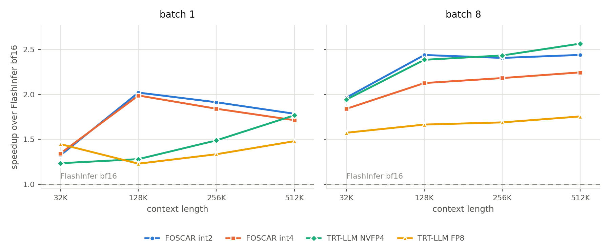
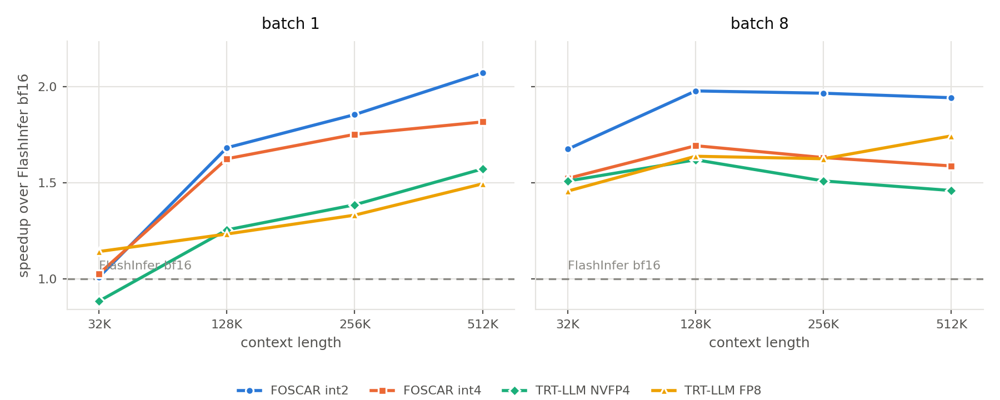
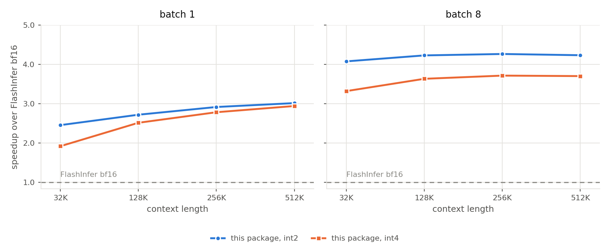
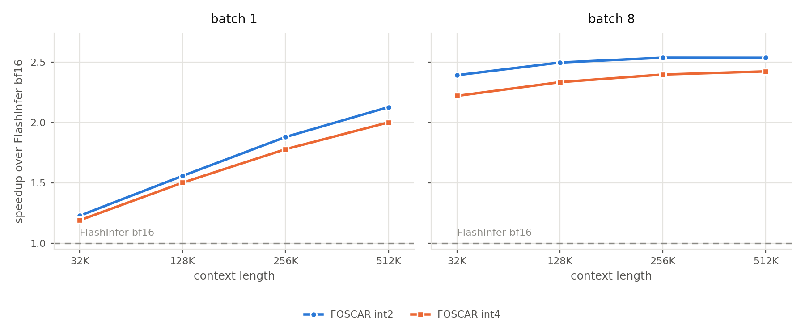

<p align="center">
  
</p>

# FOSCAR

Quantized-KV paged GQA decode kernels for Hopper (SM90) and Blackwell (SM100),
written in CuTe DSL and exposed through one architecture-agnostic wrapper.

K and V live in the cache as 2-bit or 4-bit packed integer values plus a separate
scale-and-offset pool. The kernels dequantize on chip and never materialize a
16-bit KV tile, so a decode step reads a fraction of the bytes it would read from
a bf16 cache. At 2 bits the cache costs about 2.5 bits per value including the
scale and offset, which is 6.4 times smaller than bf16 and 1.8 times smaller than
nvfp4.

## Install

From a source checkout:

```sh
git clone https://github.com/FutureMLS-Lab/FOSCAR.git
cd FOSCAR
pip install -e ".[cu13]"    # CUDA 13: Blackwell, and Hopper
pip install -e ".[cu12]"    # CUDA 12: Hopper only
```

The same extras work with `pip install "foscar[cu13]"` once the package
is published to PyPI.

The package contains no compiled extensions. Everything is JIT-compiled by
`nvidia-cutlass-dsl` on first use, and the result is memoized in process and
cached on disk across processes. Bring your own `torch>=2.4`.

Blackwell requires the `cu13` extra. The DSL's CUDA 12 backend miscompiles the
SM100 kernel, and the package refuses to compile it under that backend.

## Quickstart

```python
import torch
from foscar import PagedDecodeWrapper, QuantKVLayout, get_capabilities

device = "cuda"
arch = get_capabilities()["arch"]                 # "sm90" or "sm100"
q_dtype = torch.float8_e4m3fn if arch == "sm100" else torch.bfloat16

batch, kv_heads, q_heads, head_dim, page_size = 8, 8, 32, 128, 64
pages_per_seq, bits = 64, 2

# One layer's cache layout, resolved against the reader that will decode it.
layout = QuantKVLayout.create(bits=bits, head_dim=head_dim,
                              num_kv_heads=kv_heads, device=device)
cache = layout.allocate(batch * pages_per_seq)

# Write a token per request into the cache. k/v are bf16 [tokens, kv_heads, head_dim]
# and slot_mapping is int64: token t goes to page slot // 64, position slot % 64.
k = torch.randn(batch, kv_heads, head_dim, device=device, dtype=torch.bfloat16)
v = torch.randn_like(k)
slot_mapping = (torch.arange(batch, device=device, dtype=torch.int64)
                * (pages_per_seq * page_size))
cache.append(k, v, slot_mapping)

# Page-table inputs.
indptr = torch.arange(batch + 1, device=device, dtype=torch.int32) * pages_per_seq
indices = torch.arange(batch * pages_per_seq, device=device, dtype=torch.int32)
seq_lens = torch.full((batch,), pages_per_seq * page_size, device=device,
                      dtype=torch.int32)

q = torch.randn(batch, q_heads, head_dim, device=device,
                dtype=torch.bfloat16).to(q_dtype)

w = PagedDecodeWrapper(torch.empty(256 * 1024 * 1024, dtype=torch.uint8,
                                   device=device))
w.plan(indptr, indices, seq_lens, num_qo_heads=q_heads, layout=layout)

out = torch.empty(batch, q_heads, head_dim, device=device, dtype=torch.bfloat16)
w.run(q, cache, out=out)                    # [batch, q_heads, head_dim]
```

`plan()` compiles the kernel for one static configuration and is called when the
page table or the sequence lengths change. `run()` is called every decode step
and is graph-capturable. Call `plan()` once at model load to pay the JIT cost
before the first request.

The cache object carries the pool orders, the scale dtype and the granularity, so
`run()` takes no declaration of them: a cache built for a different layout is
refused.

### Quantization granularity

The quickstart asks for token-wise K and V: one scale and offset per token, over
the whole head dimension, which is the default. Granularity is chosen per tensor
by an `(axis, group)` pair on the layout, and the cache is written by that layout.

```python
layout = QuantKVLayout.create(bits=2, head_dim=128, num_kv_heads=8,
                              k_quant=("channel", 128),   # per channel, per 128 tokens
                              v_quant=("token", 128),     # per token over the head dim
                              device=device)
```

Accepted pairs, at `head_dim` 128:

| | token-wise | channel-wise |
|---|---|---|
| K | group `D` (default) or `D/2` | token group 64, 128 or 256 |
| V | group `D` only | token group 64, 128 or 256 |

At `head_dim` 64 and 256, both architectures build whole-head token-wise K and V
(`("token", D)` with `float32` scales). `QuantKVCache.append` and
`append_quantized` write token-wise layouts (at `head_dim` 64, 128 and 256 on
Hopper, and at `head_dim` 64 and 128 on Blackwell); channel-wise layouts are
supported in the decode kernels via `QuantKVCache.bind` / `from_buffer`.

## Support matrix

| | SM90 (Hopper) | SM100 (Blackwell) |
|---|---|---|
| Paged GQA decode | yes | yes |
| `bits` | 2, 4 | 2, 4 |
| Q dtype | bf16 | fp8 e4m3 |
| K/V | packed uint8 pools + scale pool | packed uint8 pools + scale pool |
| head_dim | 64, 128, 256 | 64, 128, 256 (256 eager only) |
| page_size | 64 | 64 |
| reductions | none, kernel (split-K with LSE merge) | none, kernel (split-K with LSE merge) |
| KV heads | 1 to 128 at 128 query heads | 1 to 128 at 128 query heads |
| quantized granularity | token `D` (at 64/128/256); token 64, channel 64/128/256 (at 128) | token `D` (at 64/128/256); token 64, channel 64/128/256 (at 128) |

`get_capabilities()` reports the same set for the running device. Requesting a
configuration outside it raises `ValueError` or `NotImplementedError` naming what
is supported.

## Writing the cache

`QuantKVCache.append` quantizes and writes tokens on the device, one launch for K
and V. `append_quantized` takes integer values an engine has already quantized.
`dequantize` reads rows back as bf16.

Every use of a page must begin with a write at position 0, and no decode of the
layer may run concurrently with an append on another stream.

## Benchmarks

Decode latency in microseconds. Each figure plots the speedup over FlashInfer
bf16 at the same shape, so the dashed line at 1.00 is bf16.

### B200 (SM100), Qwen3-8B TP1 (HQ=32 HKV=8 D=128)



| Batch | Context | FOSCAR int2 | FOSCAR int4 | FlashInfer bf16 | TRT-LLM FP8 | TRT-LLM NVFP4 |
|---:|---:|---:|---:|---:|---:|---:|
| 1 | 32K | **15.3** | 17.6 | 35.3 | 23.0 | 18.1 |
| 1 | 128K | **36.7** | 44.2 | 99.0 | 60.1 | 41.2 |
| 1 | 256K | **62.4** | 74.8 | 170.7 | 100.1 | 69.8 |
| 1 | 512K | **114.3** | 135.6 | 314.1 | 175.3 | 123.7 |
| 8 | 32K | **62.5** | 75.1 | 167.6 | 95.8 | 69.2 |
| 8 | 128K | **218.3** | 251.9 | 596.0 | 310.5 | 242.9 |
| 8 | 256K | **399.1** | 456.2 | 1172.5 | 594.3 | 474.7 |
| 8 | 512K | **758.1** | 865.7 | 2319.8 | 1166.6 | 932.7 |

### B200 (SM100), Inkling TP8 (HQ=8 HKV=1 D=128)



| Batch | Context | FOSCAR int2 | FOSCAR int4 | FlashInfer bf16 | TRT-LLM FP8 | TRT-LLM NVFP4 |
|---:|---:|---:|---:|---:|---:|---:|
| 1 | 32K | 12.9 | 12.2 | 16.7 | **11.5** | 13.8 |
| 1 | 128K | **18.2** | 18.4 | 36.4 | 29.9 | 28.4 |
| 1 | 256K | **22.4** | 22.6 | 49.2 | 37.1 | 32.2 |
| 1 | 512K | **29.4** | 31.6 | 73.9 | 49.5 | 40.4 |
| 8 | 32K | **17.3** | 18.8 | 34.8 | 22.2 | 17.7 |
| 8 | 128K | **37.5** | 44.2 | 98.5 | 59.2 | 41.6 |
| 8 | 256K | **63.2** | 72.9 | 170.6 | 100.9 | 71.3 |
| 8 | 512K | **114.8** | 126.3 | 317.4 | 179.0 | 123.9 |

### B200 (SM100), Muse-Spark-Open-816B-A42B TP8 (HQ=16 HKV=2 D=64)



| Batch | Context | FOSCAR int2 | FOSCAR int4 | FlashInfer bf16 | TRT-LLM FP8 | TRT-LLM NVFP4 |
|---:|---:|---:|---:|---:|---:|---:|
| 1 | 32K | 12.0 | 11.8 | 12.1 | **10.6** | 13.7 |
| 1 | 128K | **17.0** | 17.6 | 28.6 | 23.2 | 22.8 |
| 1 | 256K | **22.1** | 23.4 | 41.0 | 30.8 | 29.6 |
| 1 | 512K | **32.1** | 36.6 | 66.5 | 44.5 | 42.3 |
| 8 | 32K | **20.0** | 22.0 | 33.5 | 23.0 | 22.2 |
| 8 | 128K | **51.0** | 59.6 | 100.9 | 61.6 | 62.3 |
| 8 | 256K | **89.5** | 107.9 | 176.0 | 108.3 | 116.6 |
| 8 | 512K | **168.4** | 206.1 | 327.2 | 187.6 | 224.2 |

### H100 (SM90), Qwen3-8B TP1 (HQ=32 HKV=8 D=128)

TensorRT-LLM's `trtllm-gen` decode is Blackwell only, so the H100 tables have no
TensorRT-LLM columns.



| Batch | Context | FOSCAR int2 | FOSCAR int4 | FlashInfer bf16 |
|---:|---:|---:|---:|---:|
| 1 | 32K | **25.8** | 33.0 | 63.4 |
| 1 | 128K | **73.7** | 79.7 | 200.6 |
| 1 | 256K | **129.7** | 135.9 | 378.5 |
| 1 | 512K | **243.3** | 249.4 | 734.1 |
| 8 | 32K | **94.9** | 116.5 | 387.1 |
| 8 | 128K | **345.9** | 402.5 | 1463.4 |
| 8 | 256K | **681.2** | 782.0 | 2906.5 |
| 8 | 512K | **1352.2** | 1546.0 | 5726.9 |

### H100 (SM90), Muse-Spark-Open-816B-A42B TP8 (HQ=16 HKV=2 D=64)



| Batch | Context | FOSCAR int2 | FOSCAR int4 | FlashInfer bf16 |
|---:|---:|---:|---:|---:|
| 1 | 32K | **15.8** | 16.3 | 19.4 |
| 1 | 128K | **26.7** | 27.7 | 41.6 |
| 1 | 256K | **35.2** | 37.2 | 66.2 |
| 1 | 512K | **52.1** | 55.4 | 110.9 |
| 8 | 32K | **27.2** | 29.3 | 65.1 |
| 8 | 128K | **78.8** | 84.3 | 196.9 |
| 8 | 256K | **147.6** | 156.2 | 374.7 |
| 8 | 512K | **285.6** | 298.9 | 724.8 |

### Conditions

One query token per request. K and V are quantized token-wise, one scale and one
offset per token over the whole head dimension, both in FP32.
Page size 64, paged cache. Q is fp8 e4m3 on the B200 tables and bf16 on the H100
tables; FlashInfer is bf16 everywhere. Every column of a row was timed by the same
harness on the same GPU model. The number is the CUDA kernel span from CUPTI
over a cold L2, the median of the fully observed iterations, so it excludes host
dispatch and the paged-attention wrapper.

`benchmarks/decode_latency.csv` holds the values in these tables and
`benchmarks/plot_decode.py` renders the figures. The FOSCAR columns come from
`PagedDecodeWrapper`; the competitor columns from FlashInfer.

### Reproducing

```sh
pip install -e ".[bench]"    # adds FlashInfer for the competitor columns
python benchmarks/run_bench.py                              # every shape and kernel
python benchmarks/run_bench.py --shape inkling --kernel ours_int2
```

`benchmarks/bench.yaml` sets the shapes and the batch and context grid.
`run_bench.py` writes one CSV row per cell.

## Testing

```sh
pytest -q
```

Modules that need a device skip when there is none.

## Reference

If you find FOSCAR useful in your research or systems, please cite our preprint:

```bibtex
@article{zhuang2026foscar,
  title   = {{FOSCAR}: Accelerating Decode Attention over 2- and 4-Bit {KV} Caches through Affine Folding},
  author  = {Donglin Zhuang and Pragaash Ponnusamy and Xiaoxia Wu and Shuaiwen Leon Song and Zhongzhu Zhou},
  journal = {arXiv preprint},
  year    = {2026}
}
```

## License

MIT.

## Acknowledgements

This work was inspired by and builds on
[FlashInfer](https://github.com/flashinfer-ai/flashinfer),
[QuACK](https://github.com/Dao-AILab/quack) and
[flash-attention](https://github.com/Dao-AILab/flash-attention).
[NOTICE](NOTICE) records the material this package carries from them and the
licenses it is under.
