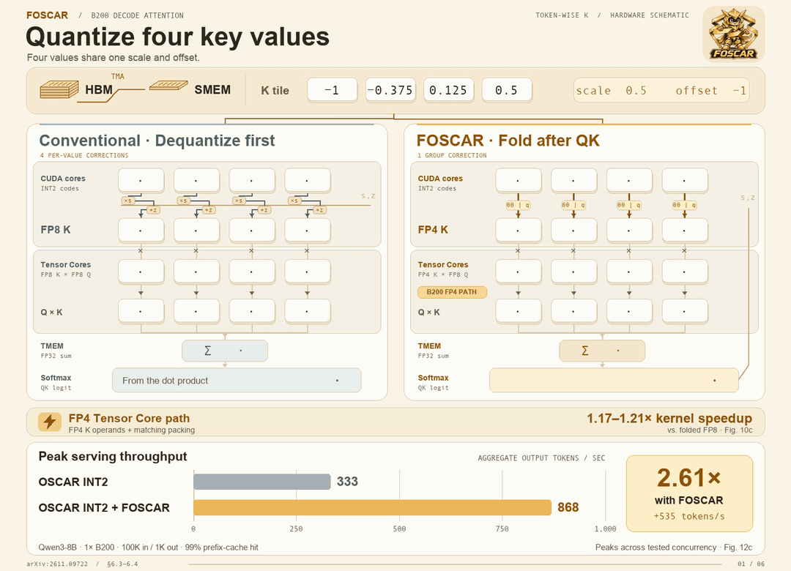

<p align="center">
  
</p>

<h1 align="center">FOSCAR: Accelerating Decode Attention over 2- and 4-Bit KV Caches through Affine Folding</h1>

<p align="center">NVIDIA Hopper and Blackwell · CuTe DSL</p>

<p align="center">
  <a href="https://arxiv.org/abs/2611.09722"></a>
  <a href="#quickstart"></a>
  <a href="#benchmarks"></a>
  <a href="docs/integration.md"></a>
  <a href="LICENSE"></a>
</p>

FOSCAR provides paged grouped-query attention (GQA) decode kernels for packed INT2 and INT4 KV caches.
Affine folding moves scale and offset arithmetic from individual KV values into the attention computation.
Both GPU backends use the same Python API.

## How FOSCAR works



Swapping the OSCAR INT2 decode kernel for FOSCAR raised peak aggregate serving throughput from **333 to 868 output tokens/s (2.61×)**. Both runs use the OSCAR cache policy and rotations on one B200 with Qwen3-8B, 100K input tokens, 1K output tokens, and a 99% prefix-cache hit rate. Each bar is the peak across the tested concurrency levels.

## Install

Requires Linux, Python 3.10+, and a CUDA-enabled PyTorch build for your GPU (`torch>=2.4`).
Choose the extra that matches your environment.
The `cu13` extra supports Hopper (SM90) and Blackwell (SM100).
The `cu12` extra supports Hopper only.

```bash
git clone https://github.com/FutureMLS-Lab/FOSCAR.git
cd FOSCAR
pip install -e '.[cu13]'
```

For Hopper with CUDA 12, use `pip install -e '.[cu12]'` instead.
Kernels compile on first use and are cached for subsequent runs.

## Quickstart

Run one decode step for two requests with two fully populated cache pages per request.
Set `bits=4` in the layout to try INT4.

```python
import torch
from foscar import PagedDecodeWrapper, QuantKVLayout, get_capabilities

device = "cuda"
arch = get_capabilities()["arch"]
q_dtype = torch.float8_e4m3fn if arch == "sm100" else torch.bfloat16
batch, q_heads, kv_heads, head_dim = 2, 32, 8, 128
page_size, pages_per_request = 64, 2
num_pages = batch * pages_per_request
seq_len = page_size * pages_per_request
num_tokens = batch * seq_len

layout = QuantKVLayout.create(bits=2, head_dim=head_dim, num_kv_heads=kv_heads, device=device)
cache = layout.allocate(num_pages)
k = torch.randn(num_tokens, kv_heads, head_dim, device=device, dtype=torch.bfloat16)
v = torch.randn_like(k)
slots = torch.arange(num_tokens, device=device, dtype=torch.int64)
cache.append(k, v, slots)

indptr = torch.arange(batch + 1, device=device, dtype=torch.int32) * pages_per_request
indices = torch.arange(num_pages, device=device, dtype=torch.int32)
seq_lens = torch.full((batch,), seq_len, device=device, dtype=torch.int32)
q = torch.randn(batch, q_heads, head_dim, device=device, dtype=torch.bfloat16).to(q_dtype)
out = torch.empty(batch, q_heads, head_dim, device=device, dtype=torch.bfloat16)
workspace = torch.empty(256 * 1024 * 1024, device=device, dtype=torch.uint8)
decode = PagedDecodeWrapper(workspace)
decode.plan(indptr, indices, seq_lens, num_qo_heads=q_heads, layout=layout)
decode.run(q, cache, out=out)
print(out.shape)  # torch.Size([2, 32, 128])
```

For page tables, cache writes, and CUDA graph capture, see the [integration guide](docs/integration.md).
See [design and internals](docs/design.md) for the backend architecture.

## Support matrix

| | Hopper (SM90) | Blackwell (SM100) |
|---|---|---|
| CUDA extra | `cu12` or `cu13` | `cu13` |
| KV storage | INT2, INT4 | INT2, INT4 |
| Query dtype | BF16 | FP8 E4M3 |
| Head dimensions | 64, 128, 256 | 64, 128, 256 |
| Page size | 64 tokens | 64 tokens |

The decode kernels support token-wise and channel-wise grouping.
The public cache writers and `dequantize()` support token-wise layouts.
To use channel-wise decode, supply a cache in the layout expected by the kernel.
Use `get_capabilities()` to check support on the current device.

<details>
<summary>Quantization groups and decode limits</summary>

| D | Tensor | layout | group size | supported? |
|---:|---|---|---:|:---:|
| 64 | K | token | 64 | Y |
| 64 | K | channel | 64, 128, 256 | Y |
| 64 | V | token | 64 | Y |
| 64 | V | channel | 64, 128, 256 | Y |
| 128 | K | token | 64, 128 | Y |
| 128 | K | channel | 64, 128, 256 | Y |
| 128 | V | token | 64 | N |
| 128 | V | token | 128 | Y |
| 128 | V | channel | 64, 128, 256 | Y |
| 256 | K | token | 64, 128, 256 | Y |
| 256 | K | channel | 64, 128, 256 | Y |
| 256 | V | token | 64, 128 | N |
| 256 | V | token | 256 | Y |
| 256 | V | channel | 64, 128, 256 | Y |

Both backends support split-K reduction and 1 to 128 KV heads at 128 query heads.

</details>

## Benchmarks

Geometric mean kernel speedup over FlashInfer BF16 for the Qwen3-8B attention shape on one GPU.
The repository harness measures batches of 1 and 8 at 32K, 128K, 256K, and 512K context lengths.
It measures GPU kernel time with a cold L2 cache and excludes host dispatch.

| GPU | FOSCAR INT2 | FOSCAR INT4 |
|---|---:|---:|
| H100 | **3.41×** | **3.00×** |
| B200 | **2.73×** | **2.33×** |

[Full results (CSV)](benchmarks/decode_latency.csv) · [Reproduction guide](benchmarks/README.md)

Expand a model below for plots and latency tables by GPU.
Head counts are per GPU after tensor parallelism (TP): HQ is the number of query heads,
HKV is the number of KV heads, and D is the head dimension.
Tables report decode latency in microseconds; plots show speedup over FlashInfer BF16
at the same shape, with a dashed baseline at 1.00×.

<details>
<summary>Qwen3-8B TP1 (HQ=32, HKV=8, D=128) · H100 / B200</summary>

### H100 (SM90)


| Batch | Context | FOSCAR int2 | FOSCAR int4 | FlashInfer bf16 |
|---:|---:|---:|---:|---:|
| 1 | 32K | **25.8** | 33.0 | 63.4 |
| 1 | 128K | **73.7** | 79.7 | 200.6 |
| 1 | 256K | **129.7** | 135.9 | 378.5 |
| 1 | 512K | **243.3** | 249.4 | 734.1 |
| 8 | 32K | **94.9** | 116.5 | 387.1 |
| 8 | 128K | **345.9** | 402.5 | 1463.4 |
| 8 | 256K | **681.2** | 782.0 | 2906.5 |
| 8 | 512K | **1352.2** | 1546.0 | 5726.9 |

### B200 (SM100)


| Batch | Context | FOSCAR int2 | FOSCAR int4 | FlashInfer bf16 | TRT-LLM FP8 | TRT-LLM NVFP4 |
|---:|---:|---:|---:|---:|---:|---:|
| 1 | 32K | **15.3** | 17.6 | 35.3 | 23.0 | 18.1 |
| 1 | 128K | **36.7** | 44.2 | 99.0 | 60.1 | 41.2 |
| 1 | 256K | **62.4** | 74.8 | 170.7 | 100.1 | 69.8 |
| 1 | 512K | **114.3** | 135.6 | 314.1 | 175.3 | 123.7 |
| 8 | 32K | **62.5** | 75.1 | 167.6 | 95.8 | 69.2 |
| 8 | 128K | **218.3** | 251.9 | 596.0 | 310.5 | 242.9 |
| 8 | 256K | **399.1** | 456.2 | 1172.5 | 594.3 | 474.7 |
| 8 | 512K | **758.1** | 865.7 | 2319.8 | 1166.6 | 932.7 |

</details>

<details>
<summary>Inkling TP8 (HQ=8, HKV=1, D=128) · B200</summary>

### B200 (SM100)


| Batch | Context | FOSCAR int2 | FOSCAR int4 | FlashInfer bf16 | TRT-LLM FP8 | TRT-LLM NVFP4 |
|---:|---:|---:|---:|---:|---:|---:|
| 1 | 32K | 12.9 | 12.2 | 16.7 | **11.5** | 13.8 |
| 1 | 128K | **18.2** | 18.4 | 36.4 | 29.9 | 28.4 |
| 1 | 256K | **22.4** | 22.6 | 49.2 | 37.1 | 32.2 |
| 1 | 512K | **29.4** | 31.6 | 73.9 | 49.5 | 40.4 |
| 8 | 32K | **17.3** | 18.8 | 34.8 | 22.2 | 17.7 |
| 8 | 128K | **37.5** | 44.2 | 98.5 | 59.2 | 41.6 |
| 8 | 256K | **63.2** | 72.9 | 170.6 | 100.9 | 71.3 |
| 8 | 512K | **114.8** | 126.3 | 317.4 | 179.0 | 123.9 |

</details>

<details>
<summary>Muse-Spark-Open-816B-A42B TP8 (HQ=16, HKV=2, D=64) · H100 / B200</summary>

### H100 (SM90)


| Batch | Context | FOSCAR int2 | FOSCAR int4 | FlashInfer bf16 |
|---:|---:|---:|---:|---:|
| 1 | 32K | **15.8** | 16.3 | 19.4 |
| 1 | 128K | **26.7** | 27.7 | 41.6 |
| 1 | 256K | **35.2** | 37.2 | 66.2 |
| 1 | 512K | **52.1** | 55.4 | 110.9 |
| 8 | 32K | **27.2** | 29.3 | 65.1 |
| 8 | 128K | **78.8** | 84.3 | 196.9 |
| 8 | 256K | **147.6** | 156.2 | 374.7 |
| 8 | 512K | **285.6** | 298.9 | 724.8 |

### B200 (SM100)


| Batch | Context | FOSCAR int2 | FOSCAR int4 | FlashInfer bf16 | TRT-LLM FP8 | TRT-LLM NVFP4 |
|---:|---:|---:|---:|---:|---:|---:|
| 1 | 32K | 12.0 | 11.8 | 12.1 | **10.6** | 13.7 |
| 1 | 128K | **17.0** | 17.6 | 28.6 | 23.2 | 22.8 |
| 1 | 256K | **22.1** | 23.4 | 41.0 | 30.8 | 29.6 |
| 1 | 512K | **32.1** | 36.6 | 66.5 | 44.5 | 42.3 |
| 8 | 32K | **20.0** | 22.0 | 33.5 | 23.0 | 22.2 |
| 8 | 128K | **51.0** | 59.6 | 100.9 | 61.6 | 62.3 |
| 8 | 256K | **89.5** | 107.9 | 176.0 | 108.3 | 116.6 |
| 8 | 512K | **168.4** | 206.1 | 327.2 | 187.6 | 224.2 |

</details>

### Measurement conditions

One query token per request. K and V are quantized token-wise, one scale and one
offset per token over the whole head dimension, both in FP32.
Page size 64, paged cache. Q is fp8 e4m3 on the B200 tables and bf16 on the H100
tables; FlashInfer is bf16 everywhere. Every column of a row was timed by the same
harness on the same GPU model. The number is the CUDA kernel span from CUPTI
over a cold L2, the median of the fully observed iterations, so it excludes host
dispatch and the paged-attention wrapper.

`benchmarks/decode_latency.csv` holds the values in these tables and
`benchmarks/plot_decode.py` renders the figures. The FOSCAR columns come from
`PagedDecodeWrapper`; the competitor columns from FlashInfer.

TensorRT-LLM's `trtllm-gen` decode is Blackwell-only, so the H100 tables have no
TensorRT-LLM columns.

## Testing

After installing the CUDA extra, install the test dependencies with `pip install -e '.[test]'` and run `pytest -q`.
Device tests skip without a supported GPU.

## License

[MIT](LICENSE).
See [NOTICE](NOTICE) for attribution and licenses for code derived from FlashInfer, QuACK, and FlashAttention.
